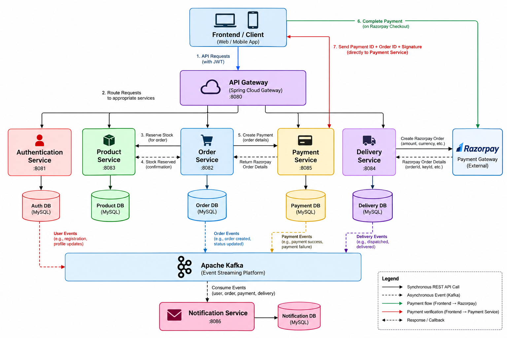

# E-Commerce Microservices Platform

A **Spring Boot-based E-Commerce Microservices Platform** built using Java, Spring Security, JWT, MySQL, Apache Kafka, Docker, and Razorpay. The application follows a distributed architecture with independently deployable services for authentication, product management, order processing, payments, delivery, and notifications.

The project focuses on service-to-service communication, secure authentication, inventory consistency, asynchronous event processing, and containerized deployment.

## Architecture



*High-level architecture illustrating the API Gateway, backend microservices, databases, Razorpay payment integration, and Kafka-based event processing.*

## Microservices

| Service | Port | Responsibility |
|---|---:|---|
| API Gateway | 8080 | Central entry point for routing client requests |
| Authentication Service | 8081 | User authentication, JWT issuance, and role-based authorization |
| Order Service | 8082 | Order creation, checkout orchestration, and order status management |
| Product Service | 8083 | Product catalog, inventory management, and stock reservations |
| Delivery Service | 8084 | Delivery tracking and delivery partner management |
| Payment Service | 8085 | Razorpay integration and payment signature verification |
| Notification Service | 8086 | Asynchronous processing of Kafka events |

## Technology Stack

- **Language:** Java
- **Backend Framework:** Spring Boot, Spring Web
- **Security:** Spring Security, JWT
- **Database:** MySQL
- **Messaging:** Apache Kafka
- **Payment Gateway:** Razorpay
- **Build Tool:** Maven
- **Containerization:** Docker, Docker Compose
- **Deployment:** Linux-based cloud VM
- **Version Control:** Git and GitHub

## Key Features

### 1. Authentication and Authorization
- JWT-based authentication and authorization.
- Public/private key-based token signing and verification.
- Role-based access control for admin, seller, and customer roles.
- Protected backend resources.

### 2. Product and Inventory Management
- Product catalog and stock management.
- Stock reservation during checkout.
- Reservation expiry and stock release mechanisms.
- Transactional inventory updates and concurrency safeguards.

### 3. Order Management
- UUID-based order identification.
- Order lifecycle management.
- Integration with Product Service for stock reservations.
- Integration with Payment Service for checkout processing.

### 4. Payment Integration
- Razorpay payment gateway integration.
- Creation of Razorpay orders through Payment Service.
- Frontend-based Razorpay checkout.
- Server-side payment signature verification.
- Communication with Order Service to update order status.

### 5. Event-Driven Notifications
- Apache Kafka for asynchronous communication.
- Event producers and consumers for user and payment-related events.
- Decoupled notification processing.

### 6. Containerization and Deployment
- Dockerized microservices.
- Docker Compose-based service orchestration.
- Environment-based configuration.
- Deployment to a cloud virtual machine.

## Application Workflows

### Checkout and Inventory Reservation

1. The frontend sends an order request through the API Gateway.
2. Order Service requests stock reservation from Product Service.
3. Product Service validates stock availability and reserves the requested quantity.
4. Product Service returns the reservation details to Order Service.
5. Order Service creates the order with a `PENDING_PAYMENT` status.
6. Order Service initiates payment creation through Payment Service.

### Payment Processing

1. Payment Service creates a Razorpay order.
2. The frontend opens Razorpay Checkout to complete the payment.
3. After checkout, the frontend sends the Razorpay payment ID, order ID, and signature directly to Payment Service.
4. Payment Service verifies the payment signature on the server.
5. Payment Service communicates the payment outcome to Order Service.
6. Order Service updates the order status based on the verified payment result.

### Event-Driven Notifications

1. Services publish relevant events to Apache Kafka.
2. Kafka distributes events to subscribed consumers.
3. Notification Service consumes and processes the relevant events asynchronously.

## Project Structure

```text
E-Commerce-Microservices/
├── AuthenticationService/
├── ProductService/
├── OrderService/
├── PaymentService/
├── DeliveryService/
├── NotificationService/
├── ApiGateway/
├── compose.yaml
└── README.md
```

## Getting Started

### Prerequisites

- Java 21
- Docker and Docker Compose
- MySQL
- Apache Kafka
- Git

### 1. Clone the Repository

```bash
git clone https://github.com/Markandey-Vatsa/E-Commerce-Microservices.git
cd E-Commerce-Microservices
```

### 2. Configure Environment Variables

Configure the required database credentials, service URLs, Kafka bootstrap servers, JWT keys, and Razorpay credentials in the appropriate environment files.

Example configuration values:

```env
DB_URL=your_database_url
DB_USERNAME=your_database_username
DB_PASSWORD=your_database_password

PRODUCT_SERVICE_URL=http://product-service:8083
PAYMENT_SERVICE_URL=http://payment-service:8085
DELIVERY_SERVICE_URL=http://delivery-service:8084

KAFKA_BOOTSTRAP_SERVERS=kafka:9092

RAZORPAY_KEY_ID=your_razorpay_key_id
RAZORPAY_KEY_SECRET=your_razorpay_key_secret
```

*These are illustrative variable names. Use the exact names expected by your application configuration.*

**Important:** Never commit credentials, private keys, or payment secrets to version control.

### 3. Build and Run

If the root Docker Compose configuration is configured with all required services, environment files, and dependencies, start the application using:

```bash
docker compose up --build -d
```

Check running containers:

```bash
docker compose ps
```

View logs:

```bash
docker compose logs -f
```

Stop the application:

```bash
docker compose down
```

Alternatively, individual Spring Boot services can be built using Maven:

```bash
./mvnw clean package
```

On Windows:

```powershell
.\mvnw.cmd clean package
```

## Testing

The application can be tested using Postman or another REST API client.

Recommended test scenarios include:

- User registration and authentication.
- JWT validation and role-based access control.
- Product listing and inventory updates.
- Stock reservation and release.
- Order creation and status transitions.
- Razorpay payment processing and signature verification.
- Kafka event production and consumption.
- End-to-end requests through the API Gateway.
- Concurrent checkout requests and inventory consistency.

## Future Enhancements

- Centralized logging and distributed tracing.
- Automated CI/CD pipelines.
- Circuit breakers, retries, and timeout management.
- Improved monitoring and service health checks.
- Comprehensive integration and concurrency testing.
- Production-grade secrets management.

## Author

**Markandey Vatsa**

GitHub: [Markandey-Vatsa](https://github.com/Markandey-Vatsa)

---

*Built to explore distributed systems, Spring Boot microservices, secure payment processing, event-driven architecture, and containerized application deployment.*
